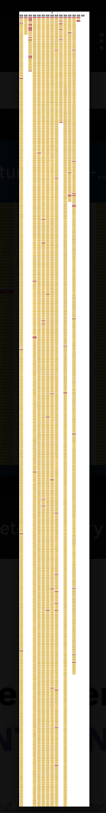
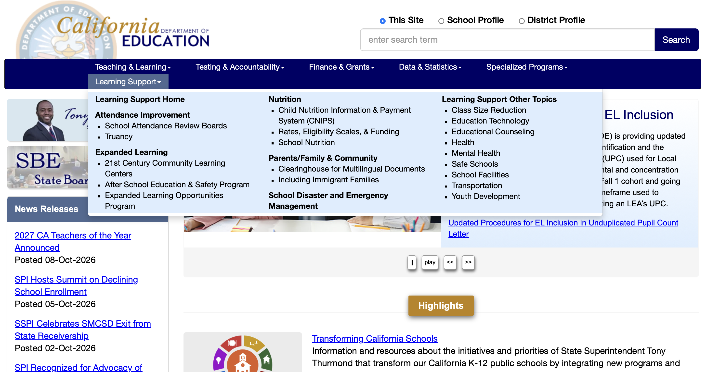
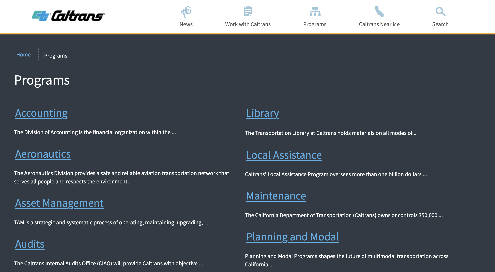

## Problem

The site is visually stuck in the early 2000s and is confusing to navigate.

## Overview

Disclaimer: This is a proposed redesign, I have no implementation access.
Reimagining a 3000+ page government website through content strategy, information architecture, and a scalable design system. In other words, this is an exploration of the content, structure, and interface of the CDE website. And some of the intranet.

To put it plainly, the California Department of Education's website is stuck in the early 2000s. In the age of AI this could be a nostalgic, intentional vibe - but there are overlooked details that make the style look schlepped together and posted as "good enough". However, I know that this team works really hard to make the site accessible, so that's a plus.

I examined the site and considered, very much, how it could support a more scalable and user-centered experience. how the experience could be improved and developed a prototype to demonstrate the proposed system.
Note, I have been thinking about this since I started working here - before the vote to incorporate CDE into the governor's rule/kingdom and always wondered why it didn't match the other ca.gov websites (they use the California State Template).

## Role

### Rogue User Experience / Design Systems Designer

- I took an existing content ecosystem, audited and structured the information architecture, identified reusable patterns, created a scalable design system, and created a prototype to show what it _could_ be.

## The Existing System

- It's large. There's a lot of pages. Lots of moving parts.
  I ran a scan with SortSite (or was it PowerMapper?) so that I could get a feel of the folder structure and it's...a lot. Check out this birds-eye view of all the pages on the site.
  

Another thing I know of the site's information architecture is that the actual content is organized by topics (and subsequently, sub-topics and sub-sub-topics), not by divisions or departments. That means that two offices or branches within the agency are able to access pages under the same content folder. For example, both a financial regulation office and a curriculum guidance office could both have access to a sub-topic folder in the "Professional Learning" area. This is great for giving web contributors the flexibility to edit the pages they need to without worrying about stepping on toes or waiting for someone to sign off on permissions. I do feel that this can get murky when it comes to a user journey, depending on the user and what they are looking for.

Alternatively, another California agency's website is organized by its programs.

Existing content structure
Existing page patterns

### Constraints

The site contains a large volume of content, so I used a representative sampling approach rather than attempting to manually inventory every URL. Although after the site scan I have a pretty good idea of the lay of the land. Additionally, CDE as an organization does not have an established style guide, although they do have preferred web standards for web contributors to use for content they want to publish to the site.

#### Interesting Tidbits

"All websites in the “ca.gov” DNS Zone must contain a direct link. to https://www.ca.gov/ and must provide both general information and details on digital services to be used on https://www.ca.gov/." [State Administrative Manual 519.5](https://www.dgs.ca.gov/Resources/SAM/TOC/5100/5195-1)

Any site with the CA.GOV domain must adhere to certain requirements, see [Website Standards 5190.1](https://www.dgs.ca.gov/Resources/SAM/TOC/5100/5190-1)

http://www.webstandards.ca.gov/

## Research and Audit

### Process for Solution

### Observations

information is difficult to locate
// similar content is structure inconsistently
navigation / content hierarchy is unclear
visual patterns vary

## Architecture

### Content Architecture

### Information Architecture

- navigation - it is currently

## Outcome

- Established a more scalable content system by creating reusable Sitecore components and page patterns, while refreshing the existing content

### Evidence

- representative sample
- screenshots
- content inventory
- anecdotal feedback

## Skill Stack

- Section 508
- WCAG
- Content governance
- Web standards
- Accessible PDF
- HTML / CSS / Javascript
- Sitecore / Drupal
