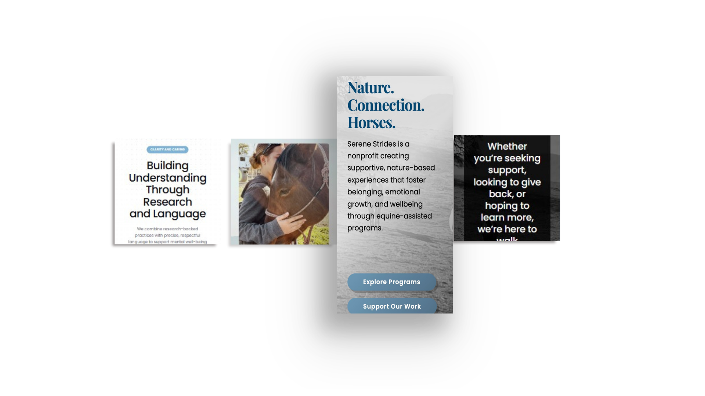
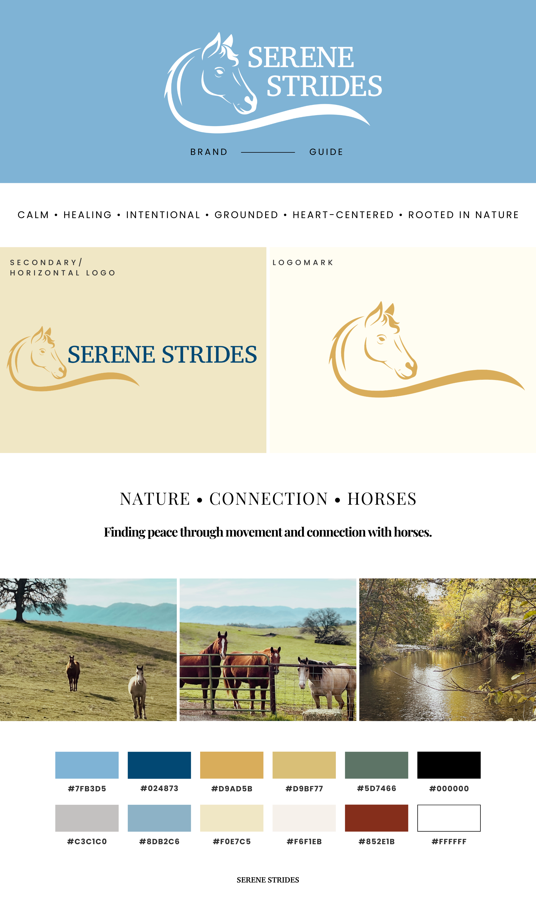
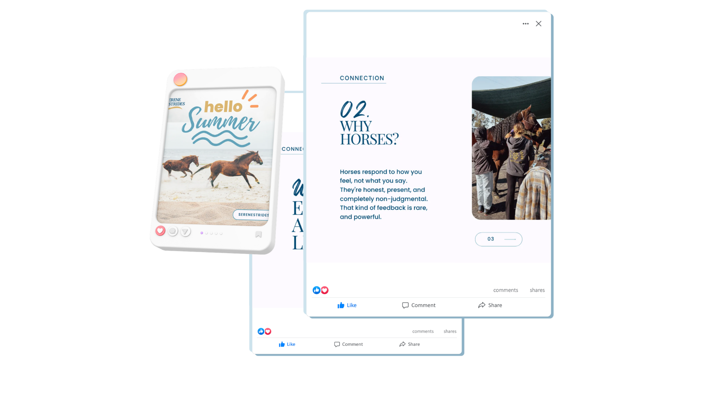
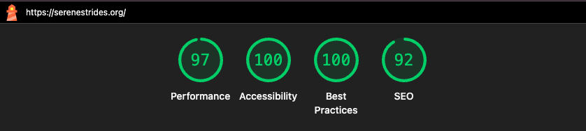
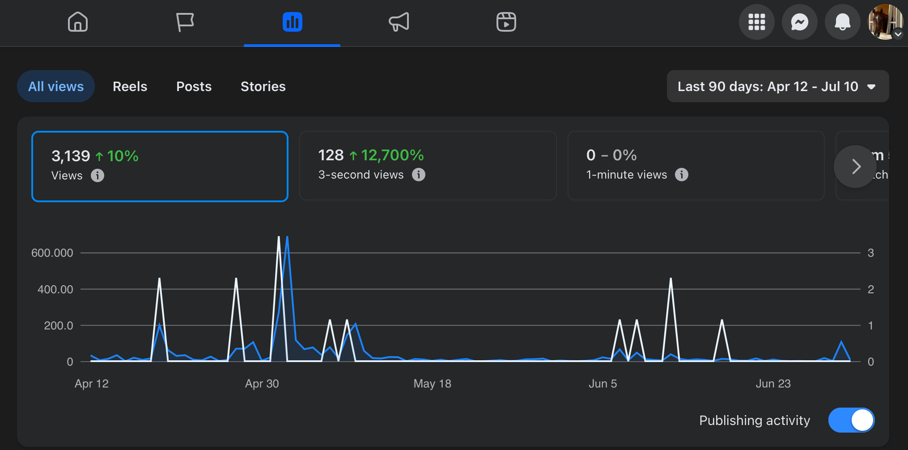

## Overview

Serene Strides is a non-profit serving youth, professionals, and community members through programs centered on nature, connection, and social-emotional learning. It's meaningful, specialized work that is deserving of a website to match. They needed their site to be visually consistent and meet basic accessibility standards.

## Role

Digital strategy · Web design · Content · Brand systems · Accessibility · Social media

## Problem

Serene Strides had meaningful programs and heartfelt stories, but their digital presence needed a change - starting with the website. The content, including the writing, needed to become clearer, more consistent, and easier to produce without creating more work for the small team.

## Approach

Even though eventually I worked through the organization's digital ecosystem, my first task was to redesign the website. My first decision was to treat accessibility as part of the architecture and not just an afterthought. WCAG compliance was baked into every color choice, component build, and content structure. I also established reusable visual and content patterns and created a style guide the team could refer to in the future.
My goal was to create a repeatable system through the website, content structure and social media materials, in addition to polishing up the site.

## Process

- I conducted a full site audit and looked for accessibility gaps, content quality, and visual consistency
- Developed a brand style guide covering typography, color palette, tone of voice
- Researched equine-assisted learning to write and shape page content accurately, using AI tools to support drafting with careful editorial review (I'm not an equine programs expert, but I wanted to make sure that users had accurate and clear information.)
- Took over social media content creation, developing posts against newly-created content pillars, writing CTAs, and creatively editing limited source photography to maintain visual brand consistency

  

  

## Outcome

- A redesigned, accessible WordPress site that reflects the organization's mission and serves their audience
- A style guide that governs both the web and social facets
- Copy and microcopy for each page that relates to the mission of Serene Strides
- Ongoing social media management with intentional visual designs, not just posting
- Accessible and interactive forms, including a registration form, liability, questionnaires, that also matched the new brand style
- An increase in traffic for both the Instagram and Facebook accounts leading to more inquiries

  

  

## Skill Stack

- WCAG
- WordPress
- Canva
- Social media
- Lightroom
- Adobe
- Jotform
- Digital Communications

### Design + Systems + Accessibility

## Links

- 🔗 [Live Site](https://serenestrides.org)
- 💾 [Instagram](https://instagram.com/serene_strides_org)
